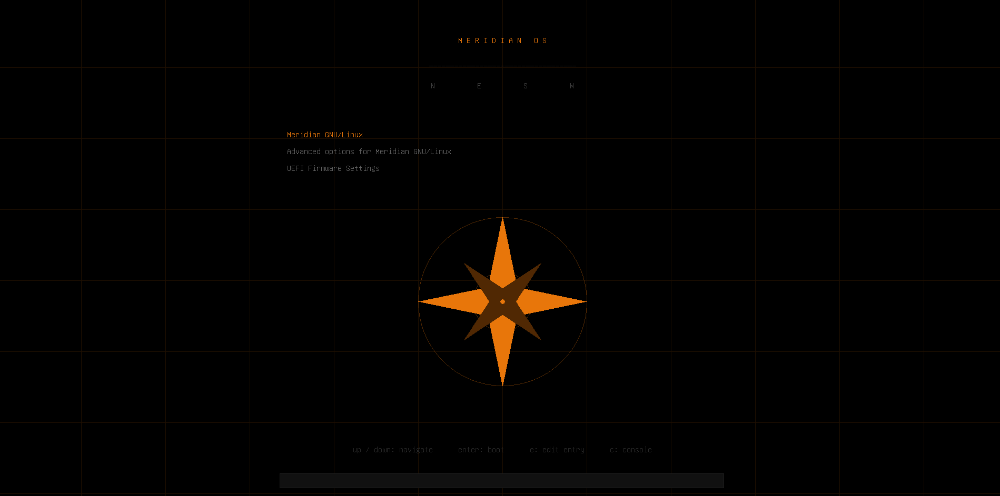
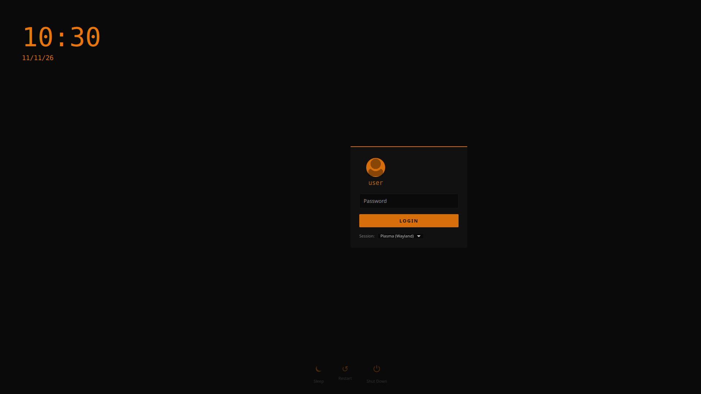
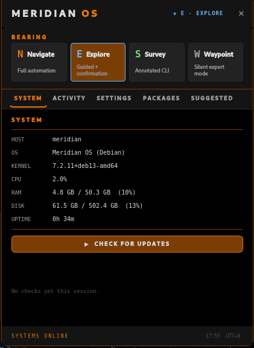
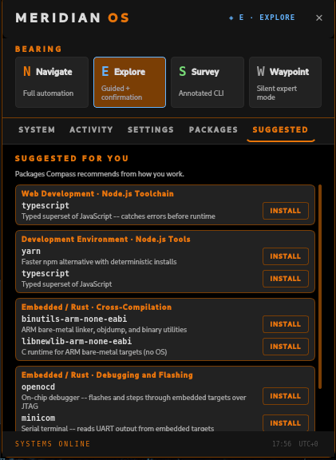

# Meridian OS

Meridian is a Debian 13 (Trixie) desktop with an adaptive guidance layer (Compass) and a pacman-style package layer (MPM) on top of an otherwise unmodified Debian base. Its defining rule is that a user's guidance level is independent of their permission level: the amount Compass explains, confirms, and automates is adjustable, but it never changes who is allowed to do what.

This repository is the project's public technical overview: what has been built, what is planned, the defects diagnosed and resolved, and the mechanisms that distinguish it from a themed Debian install. The source tree is private for now.

| | |
|---|---|
| Base | Debian 13 (Trixie): kernel, glibc, systemd, apt/dpkg inherited |
| Desktop | KDE Plasma 6 on X11 |
| Kernel | trixie-backports line, pinned via APT preferences (7.2.11 at the time of writing) |
| Guidance | Compass: one system, four bearings (Navigate / Explore / Survey / Waypoint) |
| Packages | MPM, a pacman-style CLI over apt, with a suggestion engine |
| Compass build | Python prototype in production use; Rust port scoped, not started |
| Current release | 1.1-b5, publicly shipped, bare-metal validated on Intel laptops |
| Long-term kernel | Rose, a Rust capability microkernel in development; see [rose.md](docs/rose.md) |
| Status | In daily use with a known defect list; see [Status](#9-status) |

---

## Contents

1. [What Meridian is](#1-what-meridian-is)
2. [What is different from a themed Debian](#2-what-is-different-from-a-themed-debian)
3. [The system](#3-the-system)
4. [Screenshots](#4-screenshots)
5. [Where it runs](#5-where-it-runs)
6. [Build and updates](#6-build-and-updates)
7. [Engineering and troubleshooting](#7-engineering-and-troubleshooting)
8. [Documentation map](#8-documentation-map)
9. [Status](#9-status)

---

## 1. What Meridian is

Meridian is built in three layers:

- **Base system:** Debian 13, inherited as-is (kernel, glibc, systemd, apt/dpkg). Meridian changes are applied as packages and build hooks, not as in-place edits to upstream files.
- **Compass:** an adaptive guidance system. It owns the shell hints, the tray, the installer, the first-boot wizard, and updates. It is independent of permissions.
- **MPM:** the Meridian Package Manager, a pacman-style command language (`-S`, `-R`, `-Ss`, `-Syu`) over apt, with a context-aware suggestion engine.

The design rule across all three: guidance level is not permission level. A user on full automation and a user on a bare command line have the same administrative authority; only the verbosity and confirmation differ. Target audience is desktop and workstation users across the full range of experience, on one image. The base is Debian Stable because the beginner end of that range needs a base that does not break.

Full detail: [architecture.md](docs/architecture.md).

Long term, Meridian is intended to move off the Linux kernel onto [Rose](https://github.com/TrashPanda2481/Rose-Overview), a from-scratch capability microkernel written in Rust, with Compass becoming a native layer whose authority the kernel enforces. Rose is in development and not yet usable as Meridian's kernel. The transition path and the adaptive layer's design are in [rose.md](docs/rose.md).

---

## 2. What is different from a themed Debian

A themed Debian is a stock install plus icons, a color scheme, and some dotfiles. The following are mechanisms, not cosmetics, and are what this project is:

- **Guidance separated from permission in one code path.** Every output-producing path consults a single `should_speak()` gate for the active bearing. The bearing is not a profile that unlocks features; it changes only how much is said. There is no bearing that grants privilege, so none is worth attacking to gain it.
- **Compass owns updates.** The distribution's auto-update timers (`apt-daily`, `apt-daily-upgrade`) are masked at build. Updates run as `compass update` in four explicit streams. The kernel is held by default and its upgrade confirms on every bearing, including full automation.
- **A per-user guidance daemon.** `compassd` runs on the session D-Bus with an in-memory hot path (sub-200ms), a shipped session policy file, and a strict systemd sandbox. It holds no privilege.
- **A path-confined OTA asset mirror.** Over-the-air updates of themed and system assets run through a pure-Python mirror (no shell, no `rsync`): root-only, idempotent, every write target checked against an allowlist of system prefixes, and new systemd units auto-enabled only under a known prefix.
- **A first-party installer and first-boot wizard that are Compass sessions.** The installer is `compass install`, bearing-aware from the first screen; the chosen bearing is passed to it on the kernel command line.
- **MPM suggestion engine.** Package recommendations are derived from installed-package workflow profiles and gated by a minimum-triggers threshold, not from a static list.
- **A deliberate privilege model.** The guidance daemon is unprivileged; privileged work is delegated through polkit/pkexec to an allowlisted helper that requires the administrator credential every time. A shipped checker (`check-root-syspath`) flags any non-root-writable directory on root's Python import path. Root system units carry hardening tailored to their actual needs.
- **Reproducible, pinned builds.** Build-time APT is pinned to a Debian snapshot; the kernel is pinned via APT preferences.

Where these are implemented: [architecture.md](docs/architecture.md), [compass.md](docs/compass.md), [build-system.md](docs/build-system.md), [security-model.md](docs/security-model.md).

---

## 3. The system

### The four bearings

The bearing governs verbosity and confirmation only, and is adjustable at any time (`compass set <N|E|S|W>` or the tray dial).

| Bearing | Name | Behavior |
|---|---|---|
| N | Navigate | Full automation; acts without prompting |
| E | Explore | Proposes, explains, confirms before acting (default) |
| S | Survey | Shows and annotates the real command; the user runs it |
| W | Waypoint | Silent; full manual control |

The same action produces four amounts of output. The decision and the authority behind it are identical.

### Components

- **compassd:** per-user systemd service on the session D-Bus; keeps a short session buffer and rule engine in memory; the shell hook hands it each command and reads back an `InlineOutput` signal. Falls back to a subprocess when the daemon is down. Interface in [compass.md](docs/compass.md).
- **Tray and popup:** bearing selector plus System, Activity, Settings, Packages, and Suggested tabs.
- **MPM:** pacman-style apt front end plus the suggestion engine.
- **Installer and first-boot wizard:** Compass sessions; see [installer-firstboot.md](docs/installer-firstboot.md).

---

## 4. Screenshots

**Desktop.** World map with amber coastlines and a coordinate grid, a compass rose bottom-left, a coordinate and UTC readout top-right, the bearing indicator in the top panel, and a dock.

**Boot menu.** A GRUB2 graphical theme: the wordmark, the four bearing letters, the boot entries, and a compass rose.

**Login screen (SDDM greeter).** Amber clock and date, the user card with password field and session selector, and Sleep / Restart / Shut Down controls on a black field.

**Startup splash.** The Plasma splash shown while the desktop loads after login: the wordmark and the project tagline, Control / Focus / Clarity, with a progress indicator.

**Compass, System tab.** Bearing selector, then host, OS, kernel, CPU, memory, disk, and uptime, with a Check for Updates action.

**Compass, Suggested tab.** Packages recommended from installed-package workflow profiles, grouped by workflow, each with an Install button.

---

## 5. Where it runs

| Machine | CPU | GPU | Result |
|---|---|---|---|
| Dell Latitude 7490 | Core i5, Kaby Lake Refresh | Intel UHD 620 | Full validation |
| Asus Zenbook | Core i7-1165G7, Tiger Lake | Intel Iris Xe | Full validation; cosmetic Plymouth offset |
| Desktop (Gigabyte B760M) | Core i5-14400, Raptor Lake | NVIDIA RTX 3060, proprietary driver | Primary development machine, in daily use; dual monitors; NVIDIA via the post-install Xid-109 fix |

The install path is re-validated on bare metal at each milestone build. Matrix, checklist, and known cosmetic issues: [validation.md](docs/validation.md). NVIDIA is a post-install path; see the Xid-109 entry in [engineering-log.md](docs/engineering-log.md).

---

## 6. Build and updates

Built with Debian live-build: a Debian Stable base plus numbered chroot hooks that install the theme, daemon, installer, package debs, icon pack, and first-boot machinery. Builds are snapshot-pinned. Pipeline and package-list discipline: [build-system.md](docs/build-system.md).

Updated without rebuilding the ISO, via four `compass update` streams:

| Stream | Flag | What it does |
|---|---|---|
| 1 | `--system` | apt update and upgrade, bearing-aware |
| 2 | `--meridian` | git pull, reinstall Compass, mirror assets, install newly-added packages, restart services |
| 3 | `--kernel` | gated kernel upgrade; confirms on every bearing; respects an apt hold |
| 4 | `--compass` | pull the Compass dev branch, reinstall Compass only |

Stream details and the asset-mirror invariants: [compass.md](docs/compass.md#updates).

---

## 7. Engineering and troubleshooting

[engineering-log.md](docs/engineering-log.md) is a reference of defects with symptom, diagnosis, cause, fix, and verification. Representative entries:

| Symptom | Cause | Fix |
|---|---|---|
| Display hangs at boot on every stock Trixie kernel | symbol mismatch between `i915` and `drm_display_helper` (6.12.86 to 6.12.94) | adopt the trixie-backports kernel; drop `nomodeset` |
| Installed system hangs at boot; live USB does not | an unanchored `rsync` exclude (`media`) removed `/lib/modules/*/kernel/drivers/media/`, dropping `cec.ko` | anchor exclude patterns with a leading slash |
| Installer aborts at partitioning (b18 to b23) | EFI label exceeded FAT32's 11-character limit | shorten to `MERIDIANEFI` |
| Packages vanish from the image a set at a time | `--apt-recommends false` drops Recommends-supplied packages | add each back explicitly in the package list |
| Any local user could self-authorize privileged operations | polkit actions used `auth_self_keep` instead of `auth_admin_keep` | require the admin credential |
| Printing installed but could never start | all CUPS systemd units were masked | unmask them |
| GPU crashes under load (`Xid 109`) | open-kernel-module driver unstable on this generation | closed 610.57.04 driver, GSP firmware disabled |

---

## 8. Documentation map

| Document | Contents |
|---|---|
| [architecture.md](docs/architecture.md) | the three layers, the process and privilege model, how the pieces communicate |
| [compass.md](docs/compass.md) | bearings, `compassd`, the D-Bus surface, the GUI, the four update streams |
| [build-system.md](docs/build-system.md) | the live-build pipeline, the hook chain, package-list discipline, reproducibility |
| [installer-firstboot.md](docs/installer-firstboot.md) | Compass-as-installer and the first-boot wizard |
| [engineering-log.md](docs/engineering-log.md) | defects with symptom, diagnosis, cause, fix, verification |
| [security-model.md](docs/security-model.md) | the privilege model, the IPC threat model, the hardening that shipped |
| [validation.md](docs/validation.md) | hardware matrix, confirmed-working checklist, known cosmetic issues |
| [roadmap.md](docs/roadmap.md) | deferred, open, and planned work |
| [rose.md](docs/rose.md) | the intended long-term architecture: the Rose kernel, the transition path, and the adaptive layer's design |

---

## 9. Status

In daily use, with a tracked defect list.

**Confirmed working:** boot on real hardware without workarounds; themed boot, login, and desktop; the Compass daemon, tray, and bearing state; package search and install; all four update streams; the installer and first-boot path, re-validated on bare metal.

**Open or awaiting verification:** two cosmetic kernel log lines at boot (a missing `cec.ko` provider, an Intel LPSS probe), neither affecting the display; the root account ships locked and needs a password set by hand; the Navigate-bearing automation safety gate is designed, not built; the proprietary NVIDIA driver is a post-install step; the Compass Rust port is scoped, not started; two fixes (multi-monitor panel placement, power-menu/logout greeter) await final verification.

Detail in [roadmap.md](docs/roadmap.md) and [engineering-log.md](docs/engineering-log.md).

---

*Screenshots are from a running Meridian install; the desktop coordinate readout shows a placeholder location.*
