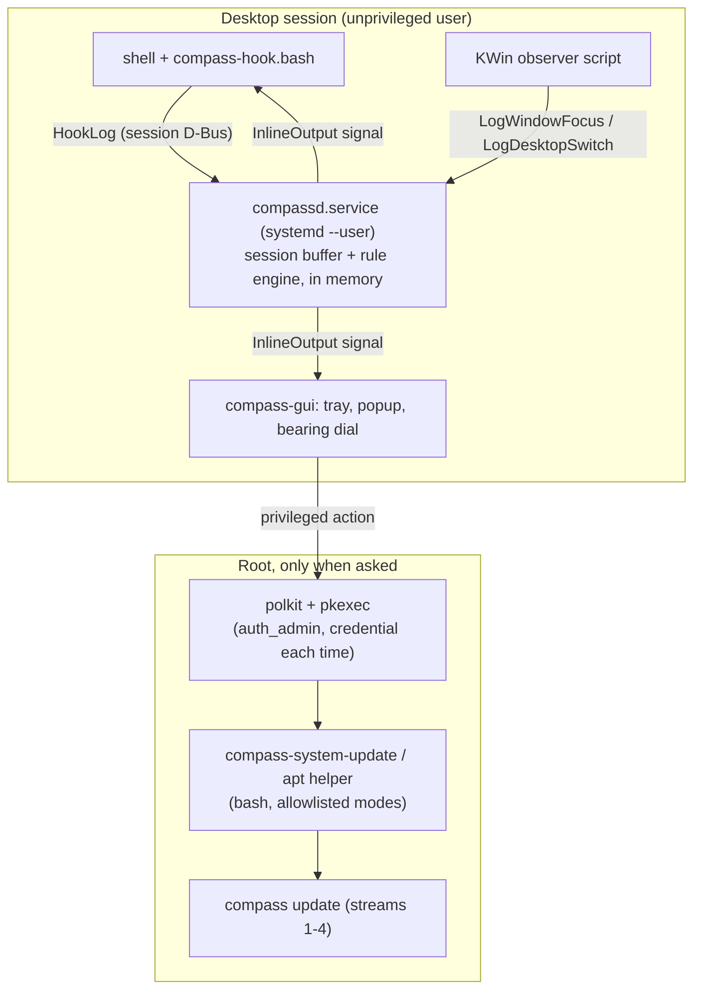

# Architecture

Meridian is a Debian Stable system with a guidance layer and a package layer built on top. Meridian-specific code lives in bounded layers on an unmodified Debian base, so the base stays recognisable and the guidance layer can be rewritten in Rust without changing the rest.

## The three layers

### Layer 1: Base system (Debian 13, Trixie)

- Kernel, glibc, systemd, and core userspace are inherited from Debian Stable. apt and dpkg stay as the engine underneath; they are just not the user-facing interface.
- The kernel is the trixie-backports line, pinned with an APT preferences file so backports packages sit at priority 600 and everything else at priority 1. This is a deliberate choice forced by hardware: see the i915 entry in [engineering-log.md](engineering-log.md).
- Meridian patches and configuration are applied on top as packages and as build hooks, not as edits to upstream files in place.

Debian Stable is the base because the beginner end of the audience needs a base that does not break.

### Layer 2: Compass, the adaptive guidance system

Compass decides how much to explain, confirm, and automate based on the active bearing, and it is the single owner of the first-run experience, the shell hints, the tray, and updates. It is independent of permissions by design.

It is organised into separation boundaries that each map to a part of the codebase:

1. **CLI shell** - what the user types (`compass`, `mpm`) and the shell hook that fires after each command.
2. **Configuration** - bearing state and per-user settings, persisted to a small config file.
3. **Interpreter / suggestion engine** - reads the recent session and decides whether to say anything.
4. **compassd** - the persistent per-user daemon that keeps the hot path in memory.
5. **KDE Plasma integration** - tray icon, popup, bearing dial, toast, and a KWin observer script.

The full module map, the D-Bus method and signal surface, and the GUI integration table are in [compass.md](compass.md).

### Layer 3: MPM, the Meridian Package Manager

A pacman-style command language (`-S`, `-R`, `-Ss`, `-Syu`) over the apt/dpkg backend, plus a suggestion engine. It is not a new package format and not a new resolver; it is a front end and an advisor:

- **Read operations** go through the `python3-apt` bindings, so searches and listings need no subprocess and no text parsing.
- **Write operations** shell out to `apt-get` with live output, so the user sees exactly what apt is doing.
- **The suggestion engine** carries workflow profiles (a web toolchain, a Python/data stack, embedded Rust, and others), each gated by a minimum-triggers threshold so a single stray command never sets one off.

## Process and privilege model

The rule that guidance level is not permission level is implemented in where privilege lives: the guidance daemon holds none, and privileged work is delegated.

- **compassd runs as the user, never as root.** Its systemd unit carries a strict sandbox (`NoNewPrivileges`, `ProtectSystem=strict`, `ProtectHome`, `ProtectKernel*`, `PrivateDevices`, `RestrictSUIDSGID`, `LockPersonality`). It keeps a short in-memory session buffer and a rule engine and nothing that needs privilege.
- **Privileged work is delegated, not inherited.** When the GUI needs root (install a package, run a system update), it goes through polkit and pkexec to a small bash helper that accepts only an allowlisted set of modes. pkexec clears the environment, so there is no `PYTHONPATH` injection path, and the polkit actions require the administrator credential every time.
- **The two root system units** (the CPU governor and the VirtualBox-additions helper) are confined with their own tailored hardening rather than copied directives, because one of them exists specifically to write `scaling_governor` and would break under a blanket `ProtectKernelTunables=yes`. The reasoning is in [security-model.md](security-model.md).

A security motivation for the planned Rust port is that it removes the Python interpreter from the privileged path; the audit is in [security-model.md](security-model.md).

## How the pieces talk

- **Shell to daemon:** the hook calls `compassd.HookLog(command, exit_code)` over the session D-Bus and reads the `InlineOutput` signal back inside a short window for inline display. If the daemon is down, the hook falls back to a `compass _hook_log` subprocess, so guidance degrades rather than disappears.
- **State files are the only shared artifact** between the CLI and GUI layers. Neither calls the other directly. Both read the bearing from one small config file; the session log is written by the hook and read by the GUI's "why" panel.
- **Bearing is checked in exactly one place.** Every output-producing path asks a single `should_speak()` helper whether the current bearing permits output, rather than each site re-implementing the N/E/S/W logic. Centralising it means the eventual Rust port changes behaviour by reimplementing one function.

## Why it is shaped for a Rust port

The Python implementation is the working prototype; Rust is the production target. The layering above reflects the port plan:

- Core functions never write to stdout directly; all output goes through one output layer, so that layer can be swapped.
- The daemon's hot path is already free of disk I/O, which is the shape a tokio event loop wants.
- The port order runs from the crate that holds no privilege (config) up to the ones that do, so privilege is introduced deliberately rather than inherited.

The full crate mapping and port order live in the private tree; the security-driven ordering argument is summarised in [security-model.md](security-model.md).
