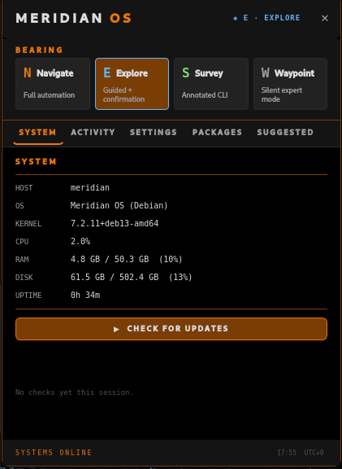
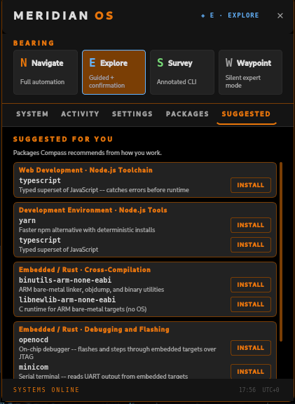

# Compass

Compass is Meridian's guidance system: the amount of explanation, confirmation, and automation scales with a setting the user controls (the bearing), which never changes who is allowed to do what. This document covers the bearings, the daemon, its D-Bus surface, the desktop app, and the four update streams.

## Bearings

The bearing is the primary control. It is adjustable at any time, including mid-task, with `compass set <N|E|S|W>` or the tray dial.

| Bearing | Name | What Compass does |
|---|---|---|
| N | Navigate | Full automation; acts without prompting |
| E | Explore | Proposes, explains, and confirms before acting (default) |
| S | Survey | Shows and annotates the real command; the user runs it |
| W | Waypoint | Silent; full manual control |

The bearing governs verbosity and confirmation only. The decision Compass would make, and the authority required to carry it out, are identical across all four. The check is centralised: every output path consults one `should_speak()` helper, so there is a single definition of what each bearing means.

A worked example is updates. The same `compass update` produces: on Navigate, a silent run that only speaks on failure; on Explore, a list of what will change and a prompt; on Survey, that plus the exact `apt-get` line annotated; on Waypoint, a quiet passthrough. One code path, four volumes.

## compassd

`compassd` is a per-user systemd service (`systemd --user`) that sits on the session D-Bus and keeps the guidance hot path in memory.

- It loads the rule set once at startup, keeps a five-entry session ring buffer and a level counter in RAM, and evaluates rules without disk I/O on the hot path.
- The shell hook hands it each command after execution; it pushes the command to the buffer, evaluates the rules, and emits an `InlineOutput` signal that the hook and the tray display. The contract is a sub-200ms turnaround so the hook can show guidance without holding up the terminal.
- It runs unprivileged, always, under a strict systemd sandbox. It never calls apt, dpkg, or any system tool.

If the daemon is not running, the shell hook falls back to a short-lived `compass _hook_log` subprocess, so a user still gets guidance, just without the in-memory speed. The hook caches daemon availability and re-checks periodically.

## D-Bus surface

The service is `org.meridian.Compass` at `/org/meridian/Compass` on the session bus, with a session policy file shipped alongside it.

**Methods**

| Method | Signature | Purpose |
|---|---|---|
| `HookLog` | `(command: Str, exit_code: UInt32) -> Str` | push a command, evaluate rules, return suggestion text or empty |
| `SetBearing` | `(key: Str) -> void` | change bearing; emits `BearingChanged` |
| `ReloadRules` | `() -> Bool` | hot-reload the rule set without restarting |
| `GetStatus` | `() -> Dict` | snapshot of bearing, level, session depth, last command |
| `GetSuggestions` | `() -> groups` | MPM workflow suggestion groups |
| `LogWindowFocus` | `(title: Str, app_class: Str) -> void` | called by the KWin observer on focus change |
| `LogDesktopSwitch` | `(desktop: UInt32) -> void` | called by the KWin observer on desktop switch |

**Signals**

| Signal | Signature | When |
|---|---|---|
| `InlineOutput` | `(bearing, text, command_chip)` | on a rule match; silent on Navigate and Waypoint |
| `BearingChanged` | `(bearing)` | after a successful `SetBearing` |
| `LevelChanged` | `(level, name)` | on a level-band transition |
| `SuggestionReady` | `(trigger_command, profile_name)` | when a workflow profile matches |

This IPC surface was audited: without a policy, same-user processes can call session-bus methods that feed a suggestion engine. The threat model, the vectors, and the shipped mitigations are in [security-model.md](security-model.md).

## The desktop app

`compass-gui` is the tray icon and the popup panel. It is built with PySide6 today; a native Plasma applet is a Phase 3 item.

The popup carries the bearing selector across the top and a row of tabs:

- **System** - host, OS, kernel, CPU, memory, disk, and uptime, with a single Check for Updates action.

  

- **Suggested** - packages recommended from how the machine is actually used, grouped by workflow, each with an Install button. The recommendations come from the MPM suggestion engine and are gated by a minimum-triggers threshold, so they reflect a pattern of use rather than one stray command.

  

- **Activity**, **Settings**, and **Packages** round out the panel with recent guidance, Compass toggles, and package search.

The GUI never calls apt or dpkg directly; every system operation goes through the apt backend, and every privileged one goes through pkexec. Several GUI defects involved Qt object lifetime and threading (unparented worker threads, widget rebuild ordering, popup dismissal); see [engineering-log.md](engineering-log.md).

## Updates

Compass owns updates. The distribution's own auto-update timers (`apt-daily`, `apt-daily-upgrade`) are masked at build time, so nothing updates the system behind Compass's back. Updates run as `compass update` in four streams, all as root, all bearing-aware.

| Stream | Flag | What it does |
|---|---|---|
| 1 | `--system` (default) | `apt-get update` and `upgrade` |
| 2 | `--meridian` | git pull, reinstall Compass, mirror themed assets, install newly-added packages, restart services |
| 3 | `--kernel` | gated kernel upgrade; always confirms, even on Navigate; respects an apt hold |
| 4 | `--compass` | pull the Compass dev branch, reinstall Compass only, no asset mirror |

### Stream 2, the heavy one

Everything Meridian ships outside the Debian package set is delivered here, in order:

1. `git pull` on the installed clone using a deploy key (permissions enforced at 0600).
2. `pip install --force-reinstall --no-deps --break-system-packages` of the checked-out Compass source. New dependencies must arrive through the ISO package list, never resolved from PyPI at update time.
3. The asset mirror (below).
4. A package-delta pass: read the build's package manifest, diff it against what is installed, install anything newly added.
5. Restart `compassd` and the GUI in the invoking user's session.

It aborts with a clear error before writing anything if the deploy key or the pinned known-hosts file is missing.

### Asset mirror invariants

Stream 2's asset sync mirrors themed files (Plasma theme, SDDM, GRUB, Plymouth, polkit, systemd units, skel, helpers) from the build tree into the live system. Its invariants:

- **Pure Python, no shell and no rsync.** An unanchored `rsync` exclude previously removed a kernel module during an install copy ([engineering-log.md](engineering-log.md)); this subsystem excludes that class of path-matching error by construction.
- **Root only.** It refuses to run for a non-root euid.
- **Path-confined.** Every write target is checked against an allowlist of prefixes (`/etc/`, `/usr/share/`, `/usr/lib/`, `/usr/local/bin/`, `/usr/local/sbin/`) before any copy. A bug, or a tampered build tree, cannot write outside those roots.
- **Idempotent.** Re-running on an already-current system does no writes beyond mtime-preserving copies and returns the same per-section status.
- **Conservative auto-enable.** It only enables new systemd units whose names start with a known Meridian prefix; anything else is written but left disabled with a warning, so a future build hook cannot silently grant itself boot-start.

### Stream 3 is gated on every bearing

The kernel stream always confirms, even on Navigate, which otherwise never prompts. Meridian holds the kernel by default so an untested transition cannot land on a working machine; the stream unholds, upgrades, and re-holds only when explicitly asked. This "confirm even on Navigate" pattern is the template for the planned Navigate-bearing safety gate on any destructive automation.
