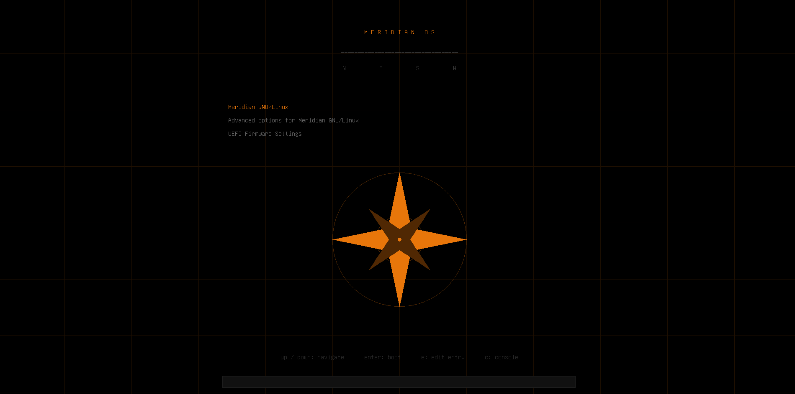

# Installer and first boot

The installer is a Compass session rather than a reskinned third-party installer: bearing-aware output and inline explanation apply from the first screen, so the interaction pattern is the same one the user will meet on the desktop. It runs as `compass install` from the live session.

## Boot entry point

The boot menu is a GRUB2 graphical theme, not the stock list: the Meridian wordmark, the four bearing letters, the boot entries, and a compass rose.

The design intent is a compass rose with five selectable points: the four bearings, which each start an install at that guidance level, and a centre point that boots the live OS to try before installing. The chosen bearing is passed to the installer on the kernel command line (`meridian.bearing=E`) and read at startup, so guidance is active from the very first prompt. The boot menu is keyboard-driven; GRUB has no mouse input, and a pre-boot graphical UI to add one is deferred as significant complexity for little gain.

## Installer flow

The steps are the same for everyone; only the amount of explanation changes with the bearing.

1. **Welcome.** A bearing-aware greeting. Explore points out that `compass why` explains what just happened, at any point.
2. **Locale and keyboard.** Language, timezone, and keyboard layout with a live test field. Survey explains what locale actually affects.
3. **Disk setup.** The default layout is a 512 MiB FAT32 EFI partition and an ext4 root filling the rest, with swap as a post-install file rather than a partition so new users never meet a partition-table edge case. Navigate proposes and confirms once; Explore explains what a partition is and shows the layout; Survey shows the partition table and explains each entry; Waypoint presents the editor with no commentary.
4. **User account.** A user account in the `sudo` group, and a root password that cannot be skipped. Explore explains root as a recovery account rather than a daily one; Survey covers UID 0, `sudo` versus `su`, and why passwordless root is unsafe. The root password is required at every bearing (a safety matter, not a verbosity one); Compass explains the requirement rather than silently imposing it.
5. **Theme.** A colour-scheme choice (Meridian Dark by default), not a full desktop reconfiguration. Navigate and Waypoint pick the default without asking.
6. **Install progress.** A progress bar with bearing-appropriate commentary, from Explore's plain-language narration to Survey's real operation names and package counts. Errors surface as Compass inline output with suggested recovery.
7. **Complete and reboot.**

### Disk operations

The partition sequence is deliberately boring and inspectable: clear signatures, write a GPT label with an EFI and a root partition, wait for the device nodes to settle, make the filesystems, and mount. Every disk command is a list-form subprocess call with no shell interpolation. Survey mode shows these commands as they run.

The FAT32 EFI label is `MERIDIANEFI` (11 characters). The earlier `MERIDIAN_EFI` and `MERIDIAN EFI` were both 12 characters, one over FAT32's label limit, which `mkfs.fat` rejected and which aborted the installer across builds b18 to b23 ([engineering-log.md](engineering-log.md)).

## First boot

A first-boot systemd user service fires on the first login, writes a completion marker, and disables itself so it never runs again.

What it does depends on the bearing, following the same principle as everything else:

- **Navigate** applies the default appearance silently.
- **Explore** offers a short guided tour: changing the colour scheme, choosing a wallpaper, how to change the bearing from here on, and where to find help (`compass explain --list`, `compass why`).
- **Survey** opens the Compass panel with the System Settings paths explained.
- **Waypoint** does nothing; the desktop is left clean.

## Bearing persistence

The bearing chosen at boot is written to the user's Compass config during account setup and becomes the default going forward. It is not locked to the install choice; `compass set <N|E|S|W>` changes it at any time, and the installer says so at the welcome step.

## Out of scope for now

Network and Wi-Fi configuration during install (handled post-install by the Plasma network manager), disk encryption, and dual-boot alongside another OS are all deferred. They are tracked in [roadmap.md](roadmap.md).
